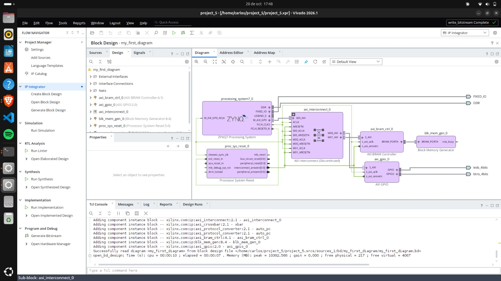
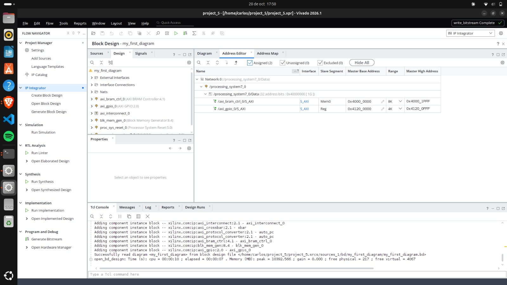
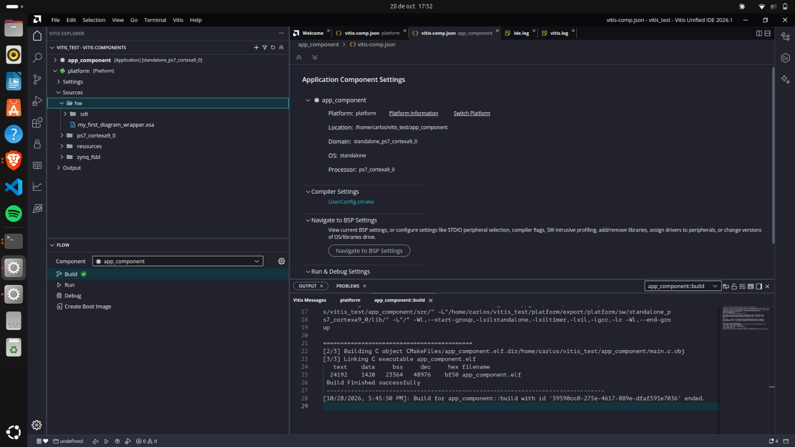

# Laboratorio 04 · SoC Zynq-7000 en Zybo Z7-10

Electrónica Digital II · Universidad Nacional de Colombia, sede Bogotá · 2026-2

| Integrante | Correo institucional |
| --- | --- |
| Julián David Saavedra Pacheco | jusaavedrap@unal.edu.co |
| Juan Sebastián Cortés Gutiérrez | jcortesgu@unal.edu.co |
| Carlos Eduardo Matheus Quintero | cmatheus@unal.edu.co |

Se implementó un SoC en una **Zybo Z7-10** con Vivado 2026.1. Un núcleo ARM Cortex-A9 ejecuta una aplicación *standalone* compilada en Vitis 2026.1 que lee cuatro botones y controla cuatro LED a través de AXI GPIO. El diseño también incorpora una BRAM de 8 KiB accesible desde el procesador. La entrega contiene el diseño, los binarios, tres capturas y el [video de la demostración física](evidencias/hardware/video-evidencia-lab04.mp4).

## Contenido

- [Arquitectura del SoC](#arquitectura-del-soc)
- [4.1 · Integración de la Zybo Z7-10](#41--integración-de-la-zybo-z7-10)
- [4.2 · Diseño e implementación en Vivado](#42--diseño-e-implementación-en-vivado)
- [4.3 · Plataforma, aplicación y ejecución en Vitis](#43--plataforma-aplicación-y-ejecución-en-vitis)
- [Resultados en la placa](#resultados-en-la-placa)
- [Archivos de entrega](#archivos-de-entrega)
- [Conclusiones](#conclusiones)

## Arquitectura del SoC

Un SoC reúne en un mismo circuito el procesador, las interfaces de memoria y otros periféricos. En el Zynq-7000, el **Processing System (PS)** contiene los núcleos Cortex-A9, las cachés, el controlador DDR y periféricos integrados como UART, temporizadores y JTAG. La **Programmable Logic (PL)** aporta recursos configurables de la FPGA, entre ellos LUT, registros, bloques DSP y BRAM. En esta práctica, la PL aloja la memoria y el GPIO, y el PS llega a ambos mediante transacciones AXI sobre direcciones de memoria. [AMD Zynq-7000](https://www.amd.com/en/products/adaptive-socs-and-fpgas/soc/zynq-7000.html)

| Bloque del diseño | Función |
| --- | --- |
| `processing_system7_0` | Ejecuta el programa en `ps7_cortexa9_0`, expone `DDR` y `FIXED_IO`, actúa como maestro por `M_AXI_GP0` y suministra reloj y reset a la PL. |
| `proc_sys_reset_0` | Recibe `FCLK_RESET0_N` y sincroniza la salida de reset con `FCLK_CLK0`. La red activa en bajo generada por `interconnect_aresetn` llega al interconector, el controlador BRAM y el GPIO. |
| `axi_interconnect_0` | Recibe el maestro del PS por `S00_AXI` y encamina las transacciones hacia el GPIO por `M00_AXI` y hacia el controlador BRAM por `M01_AXI`. |
| `axi_bram_ctrl_0` | Traduce las lecturas y escrituras AXI a operaciones sobre `BRAM_PORTA`. |
| `blk_mem_gen_0` | Implementa la memoria de un puerto, con 2048 palabras de 32 bits. |
| `axi_gpio_0` | Expone dos canales AXI4-Lite de cuatro bits. El canal 1 maneja los LED y el canal 2 lee los botones. |

## 4.1 · Integración de la Zybo Z7-10

Para instalar los board files, en Vivado se abre el catálogo de placas, se actualiza desde **Xilinx Board Store** y se instala la **Zybo Z7-10** de Digilent. Los archivos de placa proporcionan el preset del Zynq y las interfaces de los botones y los LED. El proyecto suministrado conserva `BoardPart = digilentinc.com:zybo-z7-10:part0:1.2` y `Part = xc7z010clg400-1`, lo que permite comprobar qué placa y qué dispositivo quedaron configurados. [Archivos de placa de Digilent](https://github.com/Digilent/vivado-boards) · [Proyecto Vivado](hardware/vivado/project_5.xpr)

## 4.2 · Diseño e implementación en Vivado

### Proyecto y conexiones

1. En **Create Project**, se selecciona **Boards → Zybo Z7-10** en la ventana **Default Part**. El proyecto se guardó como `project_5.xpr`.
2. Se abre **IP Integrator → Create Block Design** y se crea `my_first_diagram`.
3. Desde el catálogo de IP se agregan **ZYNQ7 Processing System**, **Processor System Reset**, **AXI Interconnect**, **AXI BRAM Controller** y **Block Memory Generator**.
4. Se conecta `M_AXI_GP0` del PS a `S00_AXI` del interconector. La rama de memoria llega a `axi_bram_ctrl_0`, que conecta su `BRAM_PORTA` al puerto homónimo del generador de memoria.
5. Desde la pestaña **Board**, se agregan **4 LEDs** y **4 Buttons** al bloque AXI GPIO. Quedan expuestas las interfaces `leds_4bits` y `btns_4bits`.
6. Se conecta `M00_AXI` a `S_AXI` del GPIO. `FCLK_CLK0` distribuye **50 MHz** al maestro AXI del PS, al interconector, al controlador BRAM y al GPIO. También alimenta `slowest_sync_clk` del bloque de reset. `FCLK_RESET0_N` llega a `ext_reset_in` y la salida `interconnect_aresetn` se distribuye a las interfaces AXI. **Regenerate Layout** ordena la vista final del diagrama.

*Figura 1. Diagrama final y puertos de placa.* [Archivo del Block Design](hardware/vivado/project_5.srcs/sources_1/bd/my_first_diagram/my_first_diagram.bd)

### Pines de los botones y los LED

El canal 1 quedó configurado como salida y el canal 2 como entrada. Los ocho pines usan `LVCMOS33`. Las restricciones automáticas de placa vinculan cada bit del periférico con su puerto externo, y el informe de E/S de Vivado indica el pin físico resultante. [Configuración del AXI GPIO](hardware/vivado/project_5.srcs/sources_1/bd/my_first_diagram/ip/my_first_diagram_axi_gpio_0_1/my_first_diagram_axi_gpio_0_1.xci) · [Restricciones generadas](evidencias/vivado/axi_gpio_board.xdc) · [Informe de E/S](evidencias/vivado/my_first_diagram_wrapper_io_placed.rpt)

| Bit | Botón · `btns_4bits_tri_i` | LED · `leds_4bits_tri_o` |
| --- | --- | --- |
| 0 | BTN0 · K18 | LD0 · M14 |
| 1 | BTN1 · P16 | LD1 · M15 |
| 2 | BTN2 · K19 | LD2 · G14 |
| 3 | BTN3 · Y16 | LD3 · D18 |

### Direcciones AXI, wrapper y exportación

7. En **Address Editor**, se usa **Assign** y se ajusta el rango del GPIO de 64 KiB a 4 KiB. La BRAM conserva 8 KiB. El BSP generado por Vitis reproduce las dos ventanas de direcciones. [Cabecera `xparameters.h`](evidencias/vitis/xparameters.h)

   | Segmento AXI | Dirección inicial | Dirección final inclusiva | Tamaño |
   | --- | --- | --- | --- |
   | `axi_bram_ctrl_0/S_AXI/Mem0` | `0x4000_0000` | `0x4000_1FFF` | 8 KiB |
   | `axi_gpio_0/S_AXI/Reg` | `0x4120_0000` | `0x4120_0FFF` | 4 KiB |

8. Sobre el diseño de bloques se usa **Create HDL Wrapper → Let Vivado manage wrapper and auto-update**. El proyecto fija `my_first_diagram_wrapper` como módulo superior. El wrapper expone `DDR`, `FIXED_IO` y los buses de botones y LED. [Wrapper Verilog](hardware/vivado/project_5.gen/sources_1/bd/my_first_diagram/hdl/my_first_diagram_wrapper.v)
9. En **Diagram**, **Run Block Automation** aplica el preset de placa, incluidas las interfaces `DDR` y `FIXED_IO` del PS. El diseño guardado conserva ambas conexiones y la configuración resultante del Zynq. [Block Design](hardware/vivado/project_5.srcs/sources_1/bd/my_first_diagram/my_first_diagram.bd)
10. Se ejecuta **Generate Bitstream**. El registro conserva la finalización del enrutado y de `write_bitstream`. Los márgenes de las rutas analizadas fueron **WNS = 9,525 ns** y **WHS = 0,027 ns**, sin extremos fallidos de *setup* o *hold*. El informe identifica cuatro entradas y cuatro salidas GPIO sin retardos externos especificados. [Registro de generación](evidencias/vivado/generacion-bitstream.txt) · [DRC](evidencias/vivado/my_first_diagram_wrapper_drc_routed.rpt) · [Informe temporal](evidencias/vivado/my_first_diagram_wrapper_timing_summary_routed.rpt) · [Utilización](evidencias/vivado/my_first_diagram_wrapper_utilization_placed.rpt)
11. En **File → Export → Export Hardware**, se selecciona la exportación **Include bitstream**. El archivo `my_first_diagram_wrapper.xsa` lleva la descripción de hardware, la inicialización del PS y el bitstream. La copia del XSA importada a Vitis coincide con la exportación de Vivado, y el `.bit` dentro del XSA coincide con el usado para programar la PL. [XSA exportado](hardware/entrega/my_first_diagram_wrapper.xsa) · [Bitstream](hardware/entrega/my_first_diagram_wrapper.bit)

*Figura 2. Mapa de direcciones del maestro del PS con dos segmentos asignados.*

## 4.3 · Plataforma, aplicación y ejecución en Vitis

1. Se abre **Tools → Launch Vitis IDE** desde Vivado.
2. En **Set Workspace** se selecciona la carpeta de trabajo. El espacio de trabajo original se llamó `vitis_test`.
3. En **Create Platform Component** se crea `platform`, se escoge **Hardware Design** y se importa `my_first_diagram_wrapper.xsa`. En **OS and Processor** se seleccionan `standalone` y `ps7_cortexa9_0`. Se revisa **Summary** y se pulsa **Finish**. Vitis prepara el BSP del dominio `standalone_ps7_cortexa9_0` con la descripción de los periféricos del XSA.
4. Se selecciona la plataforma creada y se abre **+ → Application**.
5. En **Create Application Component – Empty Application** se nombra el componente `app_component`. En **Hardware** se selecciona `platform`.
6. En **Domain** se mantiene `standalone_ps7_cortexa9_0` para ejecutar el programa directamente sobre el Cortex-A9.
7. En **Add Source Files** se incorpora `main.c`. [Código fuente](software/main.c)
8. En **Summary** se comprueban el nombre, la plataforma y el dominio y se pulsa **Finish**. [Configuración del componente](evidencias/vitis/app_component.json)
9. En **FLOW → Build**, Vitis compila `main.c` para Cortex-A9 y enlaza `app_component.elf`. El script de enlace ubica `.text` en la DDR del PS. Con la Zybo conectada por USB-JTAG, se ejecuta **FLOW → Run**. El registro muestra un primer intento detenido al iniciar XSDB y un lanzamiento posterior en el que Vitis programó la PL, ejecutó `ps7_init` y `ps7_post_config`, seleccionó el Cortex-A9 0, descargó el ELF con `dow` y reanudó el núcleo con `con`. [Script de enlace](software/lscript.ld) · [Ejecutable ELF](software/app_component.elf) · [Configuración de ejecución](evidencias/vitis/launch.json) · [Registro JTAG](evidencias/vitis/ejecucion-jtag.txt)

*Figura 3. Plataforma y aplicación en Vitis. La salida de Build confirma la generación de `app_component.elf` y el panel FLOW ofrece Run.*

### Funcionamiento de `main.c`

| Elemento | Operación |
| --- | --- |
| `LED_REG` | Escribe los datos del canal 1 en `0x4120_0000` (desplazamiento `0x00`). |
| `BUTTON_REG` | Lee los datos del canal 2 en `0x4120_0008` (desplazamiento `0x08`) y la expresión `BUTTON_REG & 0xF` toma los cuatro bits de interés. |
| `delay_with_buttons()` | Consulta los botones 1000 veces por fase. Cada consulta escribe `blink_state \| buttons`, con una espera activa de `POLL_INTERVAL = 100000` iteraciones antes de la siguiente lectura. |
| `main()` | Alterna de forma continua una fase `0xF` y una fase `0x0`. Durante la primera enciende los cuatro LED. Durante la segunda, cada bit de salida sigue la pulsación del botón correspondiente. |

Los accesos a los registros usan `volatile` para que el compilador emita las lecturas y escrituras de E/S de cada consulta. El retardo se implementa por espera activa y su duración depende de la ejecución del código en el procesador. El programa consulta los botones por sondeo. La BRAM queda mapeada en el sistema para que el PS pueda acceder a ella, aunque `main.c` solo utiliza el GPIO. [Código empleado](software/main.c) · [Guía del AXI GPIO de AMD, PG144](https://docs.amd.com/r/en-US/pg144-axi-gpio)

## Resultados en la placa

La validación solicitada consiste en dejar los botones libres para observar el parpadeo de los cuatro LED y mantener pulsado un botón durante una fase de apagado. El LED del mismo índice permanece encendido durante la pulsación y, al soltar el botón, vuelve a seguir el parpadeo. Con varios botones pulsados, la operación OR aplica la misma regla a cada bit. [Video original de la demostración física, MP4 de 15 s](evidencias/hardware/video-evidencia-lab04.mp4) · [Registro de carga y ejecución por JTAG](evidencias/vitis/ejecucion-jtag.txt)

## Archivos de entrega

| Ruta | Contenido y uso |
| --- | --- |
| [`hardware/vivado/`](hardware/vivado) | Proyecto `.xpr`, Block Design, configuraciones IP y wrapper. Abrir en Vivado 2026.1 con los archivos de placa instalados. Para reconstruir, generar los productos de salida del Block Design, ejecutar **Generate Bitstream** y exportar el XSA con bitstream. |
| [`hardware/entrega/`](hardware/entrega) | XSA para crear la plataforma de Vitis y bitstream empleado para configurar la Zynq. |
| [`software/`](software) | `main.c` para importar a una aplicación vacía, script de enlace de referencia y ejecutable original. Crear la plataforma y la aplicación en un nuevo workspace siguiendo la sección 4.3. |
| [`evidencias/capturas/`](evidencias/capturas) | Tres capturas originales del diseño, mapa AXI y compilación. |
| [`evidencias/vivado/`](evidencias/vivado) | Informes de pines, DRC, temporización, utilización y extracto de generación del bitstream. |
| [`evidencias/vitis/`](evidencias/vitis) | Configuración de aplicación y lanzamiento, cabecera del BSP y extracto de ejecución JTAG. |
| [`evidencias/hardware/`](evidencias/hardware) | Videoprueba.                 |

## Conclusiones

- El puerto `M_AXI_GP0` permitió al Cortex-A9 acceder a dos recursos de la PL mediante ventanas AXI diferenciadas. El mapa generado en Vivado se transfirió a Vitis mediante el XSA y quedó reflejado en el BSP.
- Los dos canales de `axi_gpio_0` permitieron leer los botones y controlar los LED con registros de E/S mapeados en memoria. La operación OR mantiene el LED asociado a un botón presionado durante la fase de apagado del parpadeo.
- El flujo se completó desde el Block Design hasta la ejecución *standalone* en la Zybo. El estado de la PL corresponde al bitstream y el comportamiento de los LED al ELF ejecutado en el PS.

## Referencias

- [Guía oficial de Lab04 · SoC Zynq-7000](https://github.com/jovelasquezs/2026-2_Lab_Electronica_Digital_2_G3yG4/blob/main/labs/lab04/README.md)
- [Código C suministrado para Lab04](https://github.com/jovelasquezs/2026-2_Lab_Electronica_Digital_2_G3yG4/blob/main/labs/lab04/src/main.c)
- [Digilent · Instalación de archivos de placa en Vivado](https://digilent.com/reference/programmable-logic/guides/install-board-files)
- [AMD · Zynq-7000 SoCs](https://www.amd.com/en/products/adaptive-socs-and-fpgas/soc/zynq-7000.html)
- [AMD · AXI GPIO LogiCORE IP Product Guide, PG144](https://docs.amd.com/r/en-US/pg144-axi-gpio)
